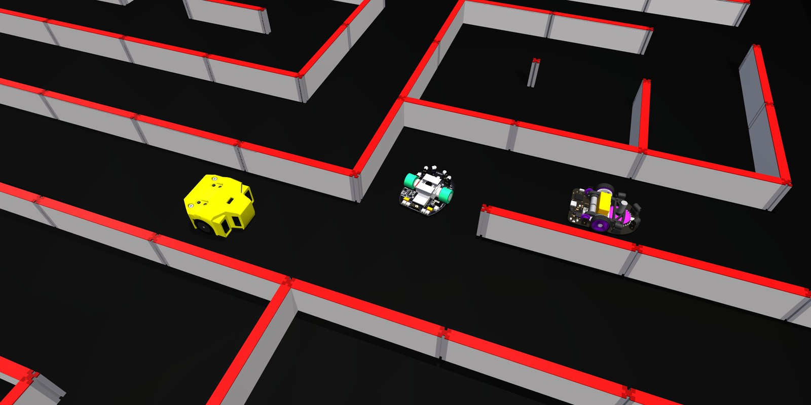
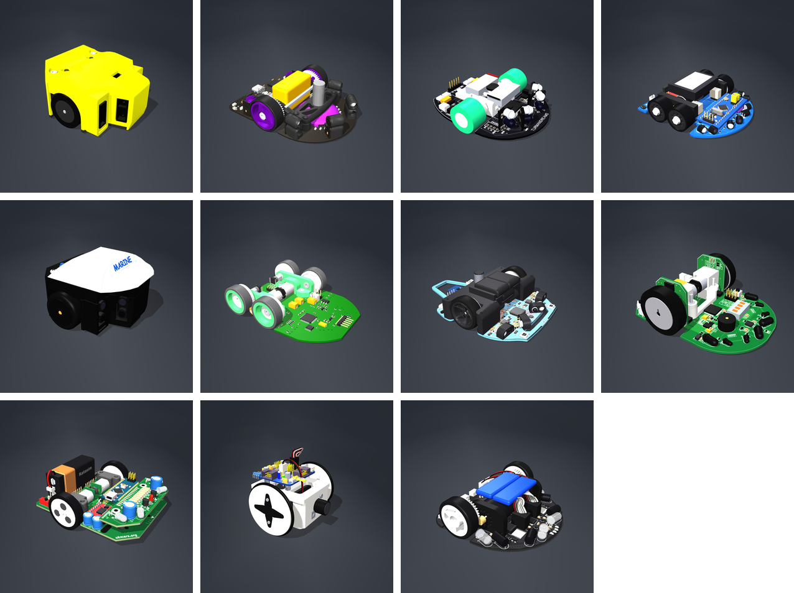
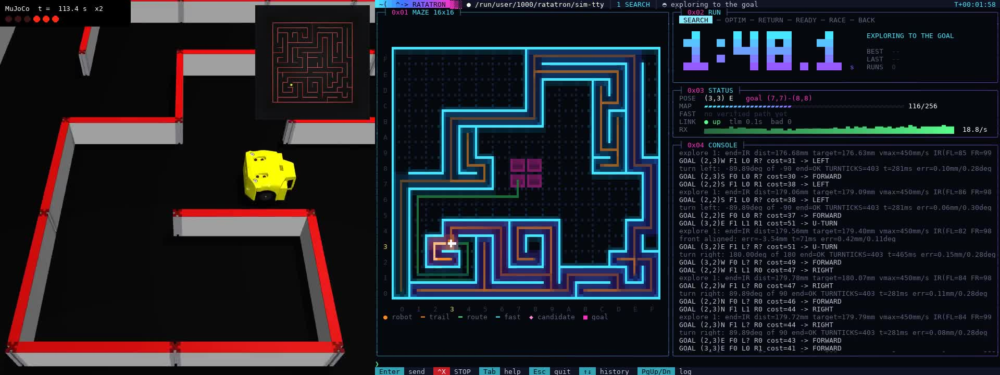
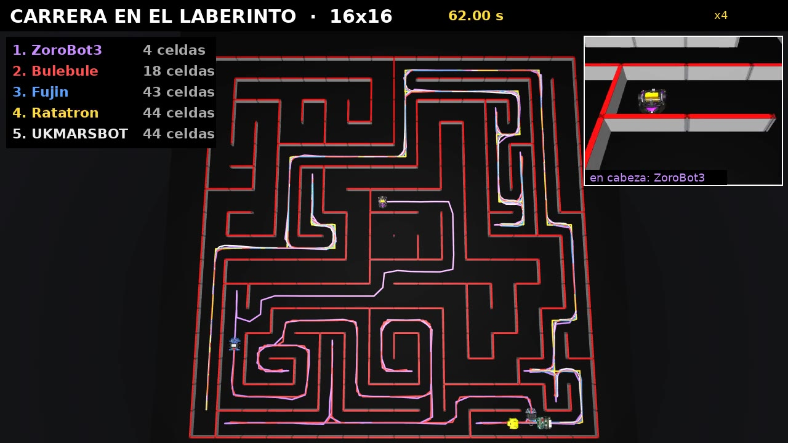
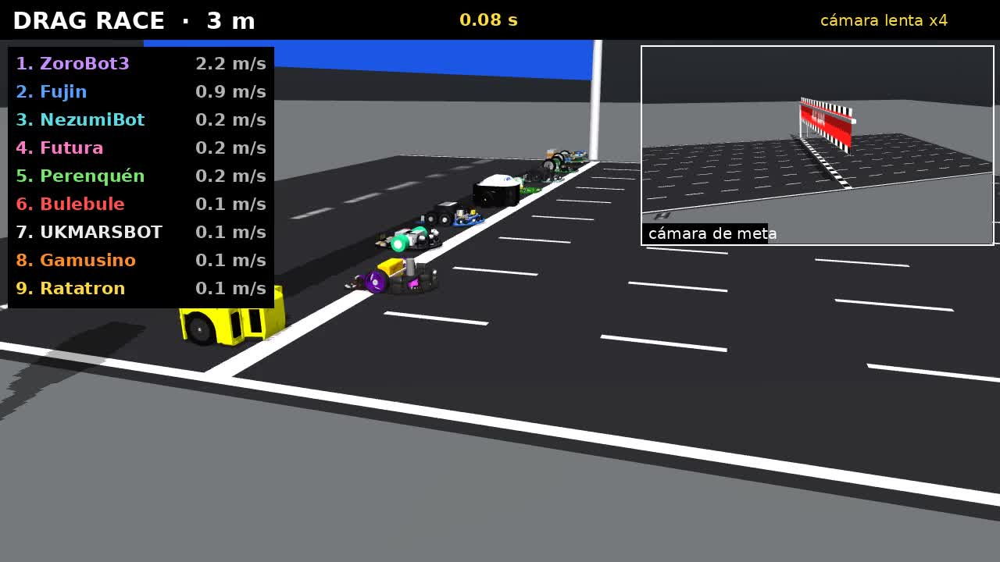
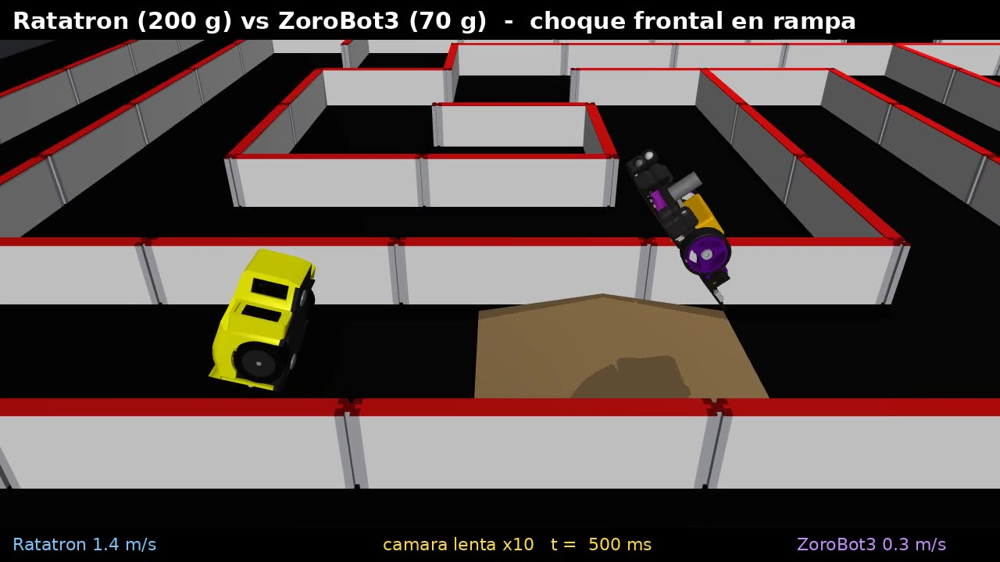
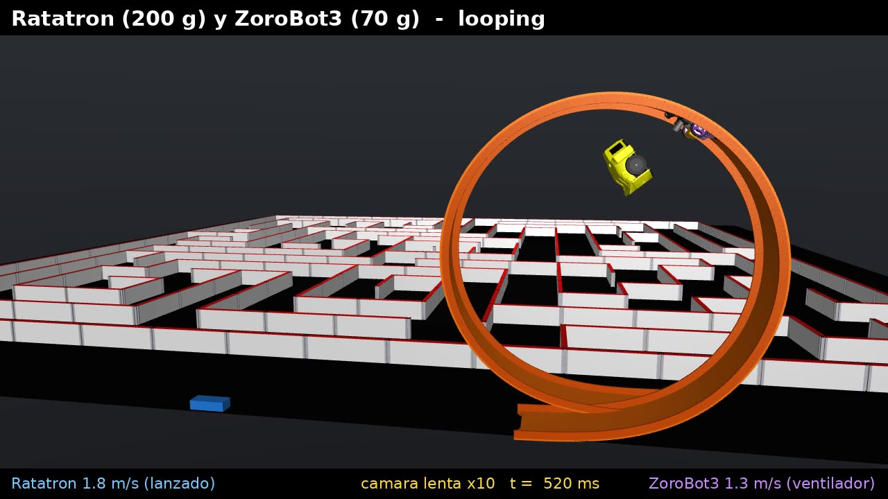

Ratasim is a micromouse simulator built on [MuJoCo](https://mujoco.org). What makes it different is that the robots aren't reimplemented: each one runs **its own firmware**, taken from its own repository and compiled for the PC unchanged, on top of a simulated chip with its motors, encoders, IR sensors, gyro, flash and serial port. The mazes follow the rules: 16x16 cells of 180 mm.



It started with [Ratatron](/robots/ratatron/), my micromouse: I wanted to test its firmware in the 16x16 maze of OSHWDem 2026 without having one at home. Then I thought it would be interesting to have more robots of the same category, to compare them and play with them.

# The robots

The robots come from Spanish competitions and from all over the world, with all kinds of chips: STM32, ESP32, ATmega, even a dsPIC.



 - **Ratatron**, mine: STM32F103, 4 Sharp IR, no gyro.
 - **ZoroBot3** and **NezumiBot**, by [OPRobots](https://oprobots.org).
 - **Gamusino**, by [turmandreams](https://github.com/turmandreams): ESP32, gyro and fan.
 - **Bulebule**, by [Bulebots](https://github.com/Bulebots): STM32F103 and 4 wheels.
 - **Perenquén**, by [supernudo](https://github.com/supernudo): a dsPIC33 with 4 wheels.
 - **Fujin**, by [Team Raiju](https://raiju.team): STM32G474 and fan, with its RCX 2026 firmware.
 - **Futura**, the UCLA IEEE kit mouse by [Green Ye](https://micromouseusa.com).
 - **UKMARSBOT**, by [UKMARS](https://ukmars.org): an ATmega328P with mazerunner-core.
 - **Miniskybot**, by [Obijuan](https://github.com/Obijuan): the classic printable robot with hacked servos and an ultrasonic sensor.
 - **KERISE v1**, by [kerikun11](https://github.com/kerikun11): with the firmware it ran at the 37th All Japan Micromouse Contest.

Each one's firmware is a git submodule pinned to a commit, so nothing of it is copied, and every robot keeps its authors' licence.

# How it works

The firmware is compiled as a library on top of a fake HAL that replaces the hardware: motors, encoders, ADCs, UART, flash, timers. Its `main()` runs in a coroutine that gives control back to the simulator every time it waits for time to pass. Every simulated millisecond the wheel angles become encoder ticks, IR rays cast against the walls become ADC readings, the firmware runs 1 ms, and its PWM becomes motor torque for the physics.

The robots are built from their own CAD files, PCBs and photos: MuJoCo models with their meshes, boards with their real silkscreen, motors where they are on the real robot. Ratatron's model is calibrated against the real one (front stops, in-place turns, slip in curves), and its firmware has already been through the 525 competition mazes from [micromouseonline/mazefiles](https://github.com/micromouseonline/mazefiles).

The robot is started as its maker does at a competition (buttons, a hand in front of its sensors...), and its serial console works as if it were over Bluetooth. With Ratatron, the same tools I use with the real robot connect to the simulated one. Here's its live monitor next to the simulator, during the search:

[](/assets/images/ratasim-ratatron-monitor.jpg)

And this is Ratatron's speed run in the OSHWDem 2026 maze, on the map saved by its search:

<iframe width="560" height="315" src="https://www.youtube.com/embed/ENReu6VZCHE" title="Ratatron's speed run in Ratasim" frameborder="0" allow="accelerometer; autoplay; clipboard-write; encrypted-media; gyroscope; picture-in-picture; web-share" referrerpolicy="strict-origin-when-cross-origin" allowfullscreen></iframe>
[]()

# Not only mazes

With so many robots in the same simulator, it's hard to resist putting them together. There's a race in the maze replaying each one's real run, a drag race, a minisumo battle with all of them on the same dohyo, a head-on crash over a ramp and a loop-the-loop:

| [](/assets/images/ratasim-maze-race.jpg) | [](/assets/images/ratasim-drag-race.jpg) |
|:-:|:-:|
| [](/assets/images/ratasim-crash-ramp.jpg) | [](/assets/images/ratasim-loop.jpg) |

The minisumo bout, all of them on the same dohyo until only one is left:

<iframe width="560" height="315" src="https://www.youtube.com/embed/IHml5APA_V0" title="Minisumo in Ratasim" frameborder="0" allow="accelerometer; autoplay; clipboard-write; encrypted-media; gyroscope; picture-in-picture; web-share" referrerpolicy="strict-origin-when-cross-origin" allowfullscreen></iframe>
[]()

# Try it

It runs on Linux (or WSL2) with Python 3.10+:

```sh
git clone https://github.com/JavierIH/ratasim
cd ratasim
git submodule update --init
python3 -m venv .venv
. .venv/bin/activate
pip install -e .[cad]
ratasim ratatron --maze oshwdem2026
```

If you have a micromouse with open firmware and you'd like to see it in Ratasim, let me know!

 - [Ratasim on GitHub](https://github.com/JavierIH/ratasim)

# License
GPLv3 or later (each robot keeps its authors' licence).
